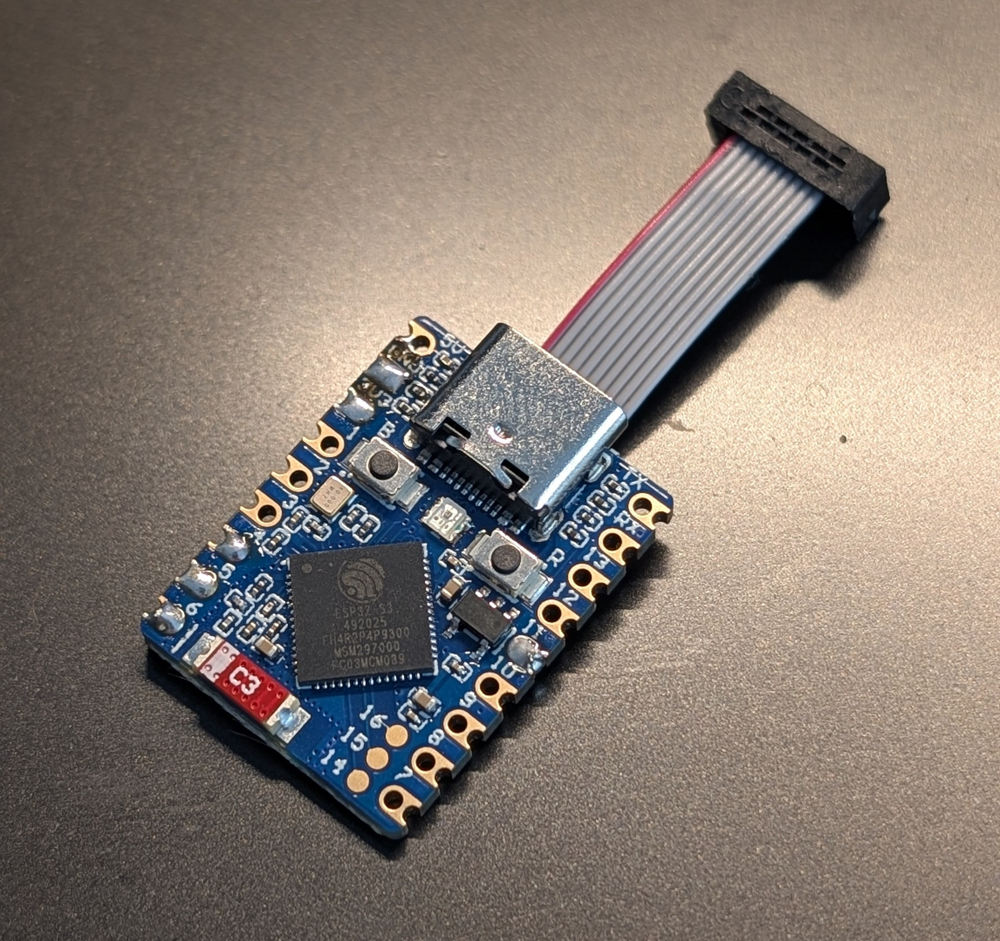

# Wireless probe

Wireless ESP32-S3 port of [Black Magic Debug Probe](https://codeberg.org/blackmagic-debug/blackmagic) optimized for high speed RAM readout for [MCUViewer](https://mcuviewer.com).

## Why 

I was fed up with the need to connect STLink with USB cable to the mobile robot I'm working on. It should be suitable for all other projects such as drones, power electronics circuits, basically wherever having a cable is problematic. Best part - it's very fast and flashing works out of the box with GDB server.




The probe serves two kinds of clients, one session at a time:

- **MCUViewer** over the NETWORK PROBE protocol (TCP port 2023). The probe connects to the
  target without halting it and reads and writes memory while it runs. It also receives the target's
  SWO pin and streams the trace bytes.
- **GDB**: BMD's GDB server over Wi-Fi (TCP port 2022). Use it for flashing and validation.

## Hardware

Reference board: Waveshare ESP32-S3-Mini. The defaults below can be changed in menuconfig
under *NETWORK PROBE SWD / Black Magic Debug port* and *NETWORK PROBE SWO*.

| Signal | GPIO |
|---|---|
| SWDIO | 4 |
| SWCLK | 5 |
| SWO (optional, input) | 6 |
| nRST (optional, open-drain) | 10 |
| GND | any GND pin |

Note: the probe is powered from your target - make sure additional power draw is acceptable in your project. 

The target must run at 3.3 V and share ground with the probe. For the future a small add-on board is planned with level translator ICs. 

### Status LED

The board's RGB LED (a WS2812 on GPIO21) shows what the probe does. GPIO, brightness and color
order are under *NETWORK PROBE status LED* in menuconfig; if red shows as green, switch the color
order.

| LED | Meaning |
|---|---|
| blue, short blinks | joining the Wi-Fi network |
| purple, breathing | setup mode: the access point is up |
| green, slow breathing | on the network, no client |
| cyan | MCUViewer connected; it dips briefly for the frames sent, so streaming flickers evenly |
| orange | GDB session; it dips briefly for the packets |
| one amber flash | samples or SWO bytes were dropped (buffer overflow) |
| one red flash | an access to the target failed, or no target answered |
| four red blinks | the target was lost, or a join from the setup page failed |
| white, speeding up | the BOOT button is held: on release before the end nothing happens |

Alerts show over the session and the network; the held button shows over everything.

## Building the firmware

Requires ESP-IDF v6.1.

```
git submodule update --init
idf.py build
idf.py -p <PORT> flash monitor
```

## Connecting the probe to Wi-Fi

The probe joins the network saved on it. Out of the box no network is saved, so it starts in
**setup mode**:

1. It opens an access point named after its device id, `network-probe-xxxxxx`: the last
   three bytes of its MAC address. The boot log prints the id too.
2. Join that network with a phone or a laptop. The setup page opens by itself (captive
   portal); if it does not, open `http://192.168.4.1/`.
3. Pick your network, enter its password and, if you like, a hostname instead of the device
   id. Only 2.4 GHz networks work.
4. The probe tries the network while its access point stays up, so the page shows the result:
   the address, or why it failed (for example a wrong password). Once connected, the probe
   saves the network and closes the access point a minute later.

At every boot the probe joins the saved network. If it gets no IP address within 15 s, setup
mode starts again, and the probe keeps trying the saved network every 30 s, so after a router
outage it comes back by itself. While the access point is up, MCUViewer and GDB also work
over it, at 192.168.4.1.

To forget the saved network, hold the BOOT button (GPIO0, see
`CONFIG_NETWORK_PROBE_SETUP_BUTTON_GPIO`) for 3 s while the probe runs. It restarts in setup
mode, or joins the default network if one is built in. Do not hold BOOT while powering up: that
starts the ESP32-S3's download mode.

The setup access point is open unless `CONFIG_NETWORK_PROBE_AP_PASSWORD` is set (at least 8
characters).

## Using MCUViewer (from v1.4.0)

In the acquisition settings pick the debug probe **NETWORK_PROBE** and enter:

- **Address**: the hostname with `.local`, by default `network-probe-xxxxxx.local`, or the IP
  address shown on the setup page or in the boot log;
- **Port**: `2023` (the field is shared with the GDB server probe, whose default is 3333);
- **SWD speed**: up to 8000 kHz is verified with a logic analyzer, faster clocks are not yet;

The probe serves one client at a time. While MCUViewer is connected, GDB connections are
refused; while GDB is connected, MCUViewer gets no answer until the GDB session ends. A second
MCUViewer connection takes over from the first.

### SWO

The probe receives SWO in NRZ (UART) encoding at up to 5 MBaud, with DMA, and passes the bytes
on unchanged: the host decodes the ITM packets. Like with an ST-Link, the host sets up the
target's trace unit (DEMCR, TPIU, ITM and the vendor's trace pin enable) itself, with memory
writes over SWD; the probe only receives. The SWO clock is the core clock divided by the trace
prescaler + 1, so pick a prescaler that keeps it at or below 5 MHz. SWO runs alongside HSS
streaming, on the same connection.

MCUViewer's trace viewer needs a NETWORK PROBE trace probe on its side to use this.

## Using GDB

```
gdb-multiarch firmware.elf
(gdb) target extended-remote network-probe-xxxxxx.local:2022
(gdb) monitor swd_scan
(gdb) attach 1
(gdb) x/8x 0x20000000
(gdb) load
(gdb) monitor frequency 8M  # change the SWD clock
```

## Timing test

`Tools/read_timing.py` measures a probe over the NETWORK PROBE protocol: the network round trip,
READ and READ_BULK throughput, a recorder-sized buffer read the way MCUViewer does it, and the HSS
sampling rate. With `--flash` it also compares READ and READ_BULK byte for byte, with 32-, 16- and
8-bit accesses; `--dump` and `--compare` keep a reference taken with another firmware. It only
reads, the target keeps running, and it leaves a probe alone that serves another session.

```
python Tools/read_timing.py 192.168.1.19 --clock 4000,8000 --flash 0x08000000
python Tools/read_timing.py --help
```

## Licensing

The firmware is GPL-3.0-or-later (see `COPYING`), as it links Black Magic Debug.
